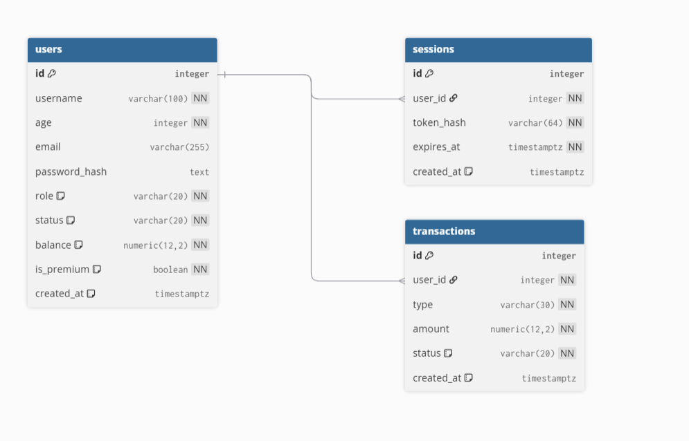

# QA Business API + PostgreSQL + Adminer + Grafana

Проект представляет собой FastAPI-сервис с 10 эндпоинтами, который подключен к базе данных PostgreSQL. Для удобного просмотра базы данных и логов используются UI-приложения Adminer (для БД) и Grafana (для логов). Отдельно заведена тестовая документация в TestIt, и развернута система управления проектами (work-flow) и баг-трекинг в YandexTracker.

## Тестовая документация проекта


* **[Тест-кейсы и чек-листы](./qa-docs/test-cases.md)**
* **[Баг-репорты](./qa-docs/bug-reports.md)** 


## Старт

Запустить в этой папке: 
```bash
docker compose up -d --build
```

- API Swagger: http://localhost:8000/docs
- Grafana: http://localhost:3000, `admin` / `admin`
- Adminer: http://localhost:8080
- PostgreSQL: `localhost:5432`, database `qa_db`, user `qa_user`, password `qa_password`

Adminer login: system `PostgreSQL`, server `postgres`, username `qa_user`, password `qa_password`, database `qa_db`.


## Описание функций 

### Обычный пользователь

- Регистрируется через `POST /api/auth/register`.
- Входит через `POST /api/auth/login` и получает Bearer-токен.
- Смотрит свой профиль через `GET /api/me`.
- Может пополнить свой баланс через `POST /api/me/deposit`.
- Может потратить `10.00` на premium через `POST /api/me/premium`.
- Не может смотреть список пользователей и менять их статус.
- Не может блокировать или разблокировать аккаунты.

### Администратор

Демо-администратор создаётся автоматически:

- Логин: `admin`
- Пароль: `admin123`

Администратор имеет все права обычного пользователя, а также может:

- Смотреть всех пользователей: `GET /api/admin/users`.
- Блокировать и разблокировать пользователя: `PATCH /api/admin/users/{user_id}/status`.


### Правила баланса

- При регистрации баланс равен `0`.
- Пользователь может сам пополнить свой баланс на положительную сумму до `10000`.
- Premium стоит `10.00`.
- Если баланс меньше `10.00`, API возвращает `402 Payment Required`.
- После успешной покупки premium баланс уменьшается на `10.00`.
- Повторная покупка premium возвращает `already_active` и повторно деньги не списывает.
- Баланс хранится в PostgreSQL в поле `users.balance`.


 
<details>
  <summary><b>Схемы</b></summary>

 | Название схемы | Тип данных | Обязательные поля | Описание свойств |
| :--- | :--- | :--- | :--- |
| **AmountInput** | object | amount | `amount`: число (до 10000.0, строго больше 0.0) или строка (валидный паттерн числа) |
| **LoginInput** | object | username, password | `username`: строка<br>`password`: строка |
| **RegisterInput** | object | username, email, password, age | `username`: строка (от 3 до 100 символов)<br>`email`: строка (от 5 до 255 символов)<br>`password`: строка (от 6 до 128 символов)<br>`age`: целое число (от 18 до 120) |
| **StatusInput** | object | status | `status`: строка, строго соответствующая паттерну `^(active\|blocked)$` |
| **ValidationError** | object | loc, msg, type | `loc`: массив строк или чисел (путь к ошибке)<br>`msg`: строка (сообщение)<br>`type`: строка (тип ошибки) |
| **HTTPValidationError** | object | нет | `detail`: массив объектов типа ValidationError |

</details>


## Grafana

Старт

```logql
{job="qa-api"}
```

Поиск по трейс-айди:

```logql
{job="qa-api"} | json | trace_id="PASTE_REQUEST_ID_HERE"
```

Поиск по статус-кодам:

```logql
{job="qa-api"} | json | status_code=401
```
По уровню логирования:
```logql
{job="qa-api"} | json | level = "error"
```


## DATABASE
*вывод всех пользователей для админа*
```sql
SELECT id, username, email, role, status, balance, is_premium, created_at FROM users ORDER BY created_at DESC LIMIT 100
```
*топ богатых пользователей*
``` sql
SELECT username, balance, is_premium FROM users WHERE status = 'active' ORDER BY balance DESCLIMIT 10
```
**ТАБЛИЦЫ**



