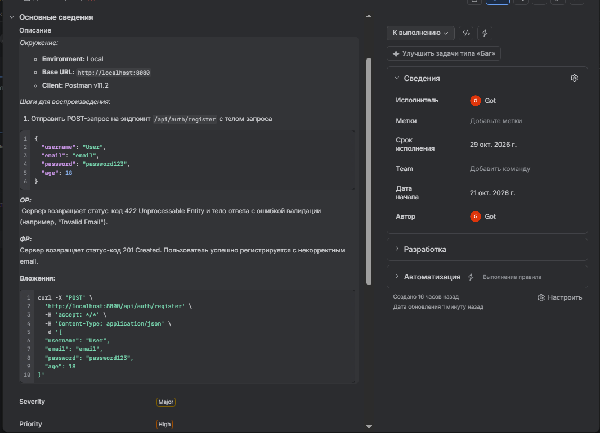
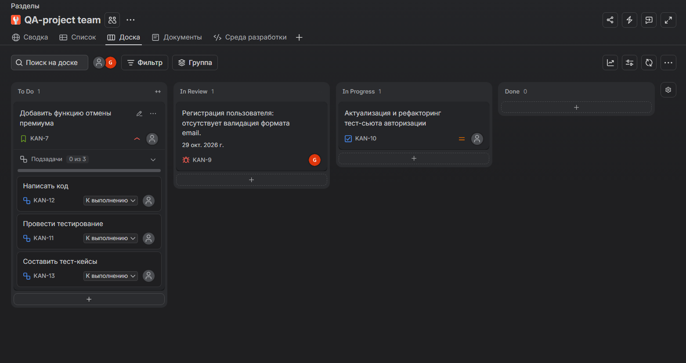

[⬅️ Вернуться на главную страницу проекта](../README.md)

## В данной папке представлены баг-репорты.

 Оформленный баг-репорт в Jira

---

Организованный ворк-флоу в Jira

---

Различные баг-репорты из существующих сервисов
  

<blockquote> 

Сервис Stellantis
 

<h3>ID-1. [prod] Кнопка “Регистрация” не активна после попыти ввода невалидных данных на странице регистрации. </h3>

**Шаги воспроизведения:**
1.	Перейти на страницу регистрации https://stellantis.autocrm.ru/register
2.	Заполнить поля невалидными данными, например:

Электронная почта: ``test``  
Пароль: ``password``  

3.	Нажать: “Зарегистрироваться”
4.	Изменить данные полей на валидные, например:

Электронная почта: ``test@domain.com``      
Пароль: ``password``  

**ОР:** Кнопка “Зарегистрироваться” активна, можно совершить попытку регистрации с валидными данными.  
**ФР:** Кнопка Зарегистрироваться” не активна, требуется принудительное обновление страницы, с потерей введенных данных. 

**Severity:** Major  
**Priority:** High 
 

---

<h3>ID-2. [prod] Ошибка локализации плейсхолдера на английской версии сайта.</h3>

**Шаги воспроизведения:**
1.	Перейти на страницу регистрации https://stellantis.autocrm.ru/register
2.	В правом верхнем углу страницы выбрать язык ENG.

**ОР:** Плейсхолдеры полей регистрации на английском языке.    
**ФР:** Плейсхолдеры полей регистрации на русском языке.

**Severity:** Trivial  
**Priority:** Low

---

<h3>ID-3. [prod] Отсутствует тримминг поля “Электронная почта” на странице регистрации</h3>

**Шаги воспроизведения:**
1.	Перейти на страницу регистрации https://stellantis.autocrm.ru/register
2.	Заполнить поля валидными данными, например:

Электронная почта: ``test@mail.ru``  
Пароль: ``password``

3.	Добавить пробел в конце или начале поля “Электронная почта”.

**ОР:** Поле “Электронная почта” валидно. Кнопка регистрации активна.  
**ФР:** Поле “Электронная почта” невалидно. Кнопка регистрации заблокирована. 

**Severity:** Minor  
**Priority:** Low

---

<h3>ID-4. [prod] Некликабелен номер поддержки на странице регистрации</h3>

**Шаги воспроизведения:**
1.	Перейти на страницу регистрации https://stellantis.autocrm.ru/register 
2.	В левом нижнем углу страницы нажать на номер телефона поддержки.

**ОР:** Номер телефона кликабелен. Открывается приложение для звонка.  
**ФР:** Номер телефона некликабелен. Телефон нужно копировать вручную. 

**Severity:** Trivial  
**Priority:** Low

 

Сервис КИНОПОИСК
 
<h3>ID-1. [prod][android] Не исчезает поп-ап после добавления фильма в "Буду смотреть"</h3>

**Окружение:**  

Стенд: prod  
ОС: Android

**Предусловие:**

1. Пользователь авторизован.

**Шаги воспроизведения:**
1.	Открыть мобильное приложение Кинопоиск на андроид.
2.	Перейти на страницу любого фильма.
3.	Нажать кнопку "Буду смотреть"
4.	Дождаться появления попапа "Добавлено в буду смотреть"

**ОР:** Поп-ап самостоятельно исчезает  
**ФР:** Поп-ап не исчезает и не смахивается

**Severity:** Major  
**Priority:** High

</blockquote>

