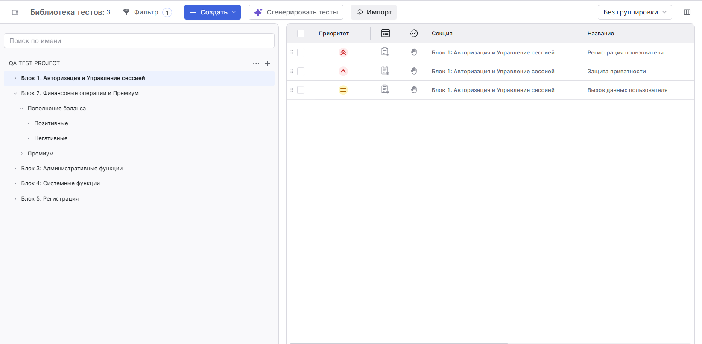
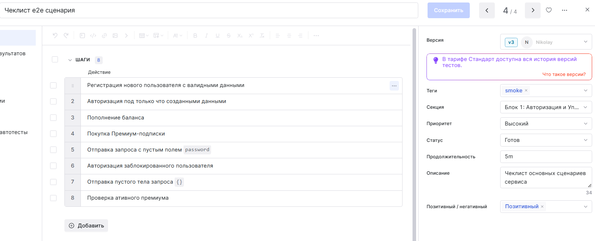
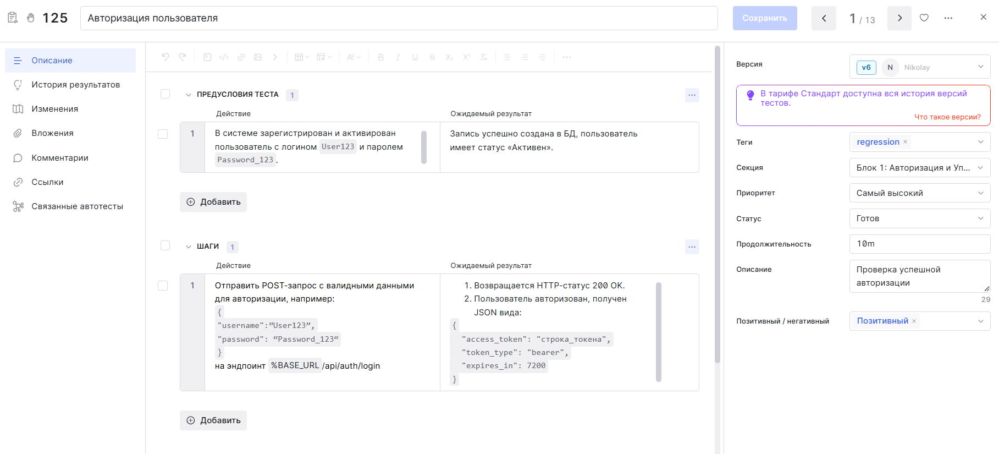
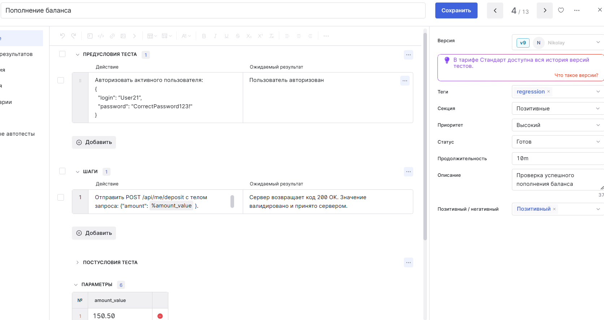
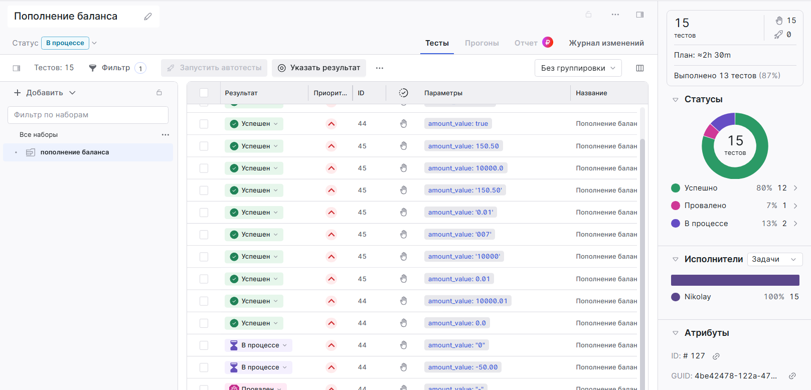

[⬅️ Вернуться на главную страницу проекта](../../README.md)

## Здесь представлена организация тест-кейсов и чек-листов в TestIt

 Пример организации библиотеки тестов

Пример чеклиста е2е сценария

 Пример тест-кейса

 Пример параметризированного тест-кейса

Собранный тест-план из параметризированных тест-кейсов

 

